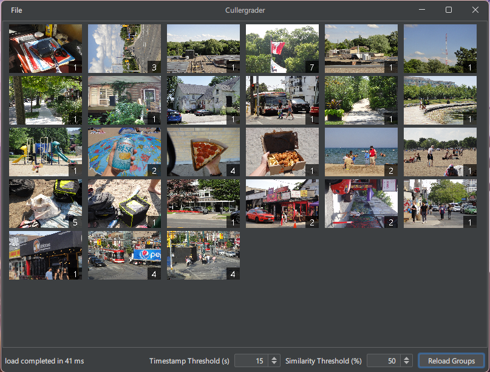
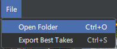
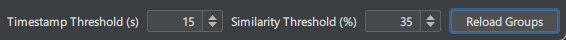
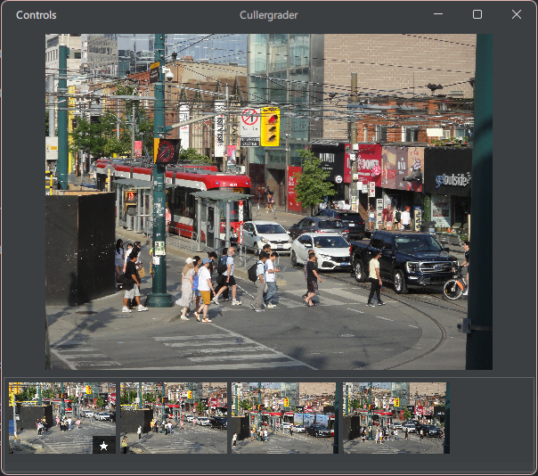
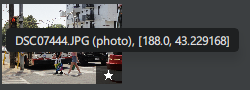
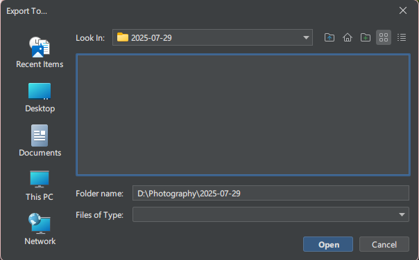

# Cullergrader
**Cullergrader** is a simple Java GUI made for photographers that groups and exports images based on <a href="https://en.wikipedia.org/wiki/Perceptual_hashing" target="_blank">**perceptual similarity**</a> (and timestamps), allowing users to select the best shots from each set of similar, consecutively taken photos.

Like many photographers, I have the habit of taking the same shot multiple times and selecting the best one to keep. However, when going through thousands of photos, this process of culling images is time-consuming, and tools such as <a href="https://github.com/qarmin/czkawka" target="_blank">**Czkawka**</a> (a large inspiration for this project) can detect a few _very similar_ images, but isn't sensitive enough to group _somewhat similar_ bursts.

Cullergrader is named for being a tool that culls and grades* photos. Please note that it doesn't actually _colour grade_ photos.

<sub>* grading photos has yet to be implemented...</sub>

<div style="display: flex; justify-content: center; align-items: center; gap: 20px;">
    
    
</div>
<p align="left">For example: Cullergrader would mark these two images as "similar" (at similarity threshold >= 37%)</p>

## Table of Contents
1. [Features](#features)
2. [Installation](#installation)
    1. [Installers (Recommended)](#installers-recommended)
    2. [Portable Zip](#portable-zip)
    3. [Compiling from Source](#compiling-from-source)
    4. [Building an Installer](#building-an-installer)
3. [How to Use](#how-to-use)
   1. [Open a Folder of Images](#1-open-a-folder-of-images)
   2. [Calibrate Grouping Settings](#2-calibrate-grouping-settings)
   3. [View Photos and Select Takes](#3-view-photos-and-select-takes)
   4. [Export Selected Takes](#4-export-selected-takes)
   5. [Pick Up Where You Left Off](#5-pick-up-where-you-left-off)
4. [Config](#config)
   1. [Where Cullergrader Stores Its Files](#where-cullergrader-stores-its-files)
   2. [Default Config](#default-config)
   3. [Config Settings Explained](#config-settings-explained)
5. [Performance Tuning](#performance-tuning)
6. [Contributing](#contributing)
7. [License](#license)

## Features
- 100% free and open-source!
- Experimental RAW image format support - works with most camera RAW files that contain an embedded JPEG preview
- Configurable options for calibrating your perceptual hash
    - Hash similarity
    - Timestamp difference
- Exports the best takes to any folder on your computer
- Runs on Windows, Mac, Linux, and anything else that supports Java GUIs
- Blazingly-fast thanks to configurable multithreading support
- Caches images -- future scans should be incredibly fast!
- Saves your progress automatically -- close the app and pick up where you left off
- Extra information about images available on hover
- Runs completely offline, and never connects to the internet
- Logs information to .txt files
- Light/Dark themes from FlatLaf
- Configurable:
    - Multithreading
    - Hashing settings
    - Cache options
    - Grouping settings
    - Dark theme




## Installation

### Installers (Recommended)
Download the installer for your system from [GitHub Releases](https://github.com/PenguinPush/cullergrader/releases). Java is bundled in, so there's nothing else to install.

| System                | File                         |
|-----------------------|------------------------------|
| macOS (Apple Silicon) | `Cullergrader-<version>.dmg` |
| Windows               | `Cullergrader-<version>.msi` |
| Debian / Ubuntu       | `cullergrader_<version>.deb` |

**Note**: the installers aren't code-signed yet, so your system may warn you the first time:
- **macOS**: if it says the app "can't be opened", right-click `Cullergrader.app` in Applications and choose `Open`, or allow it under `System Settings > Privacy & Security`
- **Windows**: if SmartScreen appears, click `More info > Run anyway`

### Portable Zip
For other systems (such as Intel Macs), or if you'd rather not install anything:
1. Install a Java 8 JRE or newer
2. Download `cullergrader-<version>.zip` from [GitHub Releases](https://github.com/PenguinPush/cullergrader/releases)
3. Extract it to any folder and run `cullergrader-<version>.jar`

**Note**:
- If you want to view logs in console, please use `run.bat` or `run.sh` depending on your operating system
- **Using console is highly recommended for large batches of images (or on slow drives), as there is no other way to monitor slow hashing progress!**

### Compiling from Source
1. Ensure you have the following installed:
    - Java Development Kit (JDK) 8 or newer
    - Apache Maven
2. Clone the repository with:
   ```bash
   git clone https://github.com/PenguinPush/cullergrader.git
   cd cullergrader
   ```
3. Build the project with the following command:
    ```
    mvn clean install
    ```
4. Extract the generated `target/cullergrader-<version>.zip` and run as described in [Portable Zip](#portable-zip)

### Building an Installer
Native installers are built with `jpackage`, which needs JDK 17 or newer. After building from source:
```bash
bash packaging/build-installer.sh
```
This makes a `.dmg` on macOS, a `.msi` on Windows (requires the [WiX Toolset v3](https://github.com/wixtoolset/wix3/releases)), or a `.deb` on Linux, in `target/installer/`. You can also pass a type explicitly, e.g. `app-image`, `pkg`, `exe`, or `rpm`.

Pushing a version tag (e.g. `v1.1.0`, matching `<version>` in `pom.xml`) builds all three installers on GitHub Actions and attaches them to a draft release.

## How to Use
### 1. Open a Folder of Images
Folders can be opened from `File > Open Folder` or with `Ctrl + O`. The first time images are computed, it may take a few minutes (but often less) to hash the images, depending on image count and disk speed. Hashes are cached for future use in `hashes.json` in Cullergrader's [data folder](#where-cullergrader-stores-its-files) (configurable via `CACHE_FILE`), so as long as this file stays intact, future computations of the same images will be nearly instant.



### 2. Calibrate Grouping Settings
Although the default settings are designed to work fine out of the box, depending on many factors in your photo, and your style of photography, manual calibration is often recommended. By adjusting the timestamp and similarity thresholds and hitting `Reload Groups`, you can adjust how your images are grouped until the grouping behaves as expected.
- `Timestamp Threshold` is the amount of seconds between two photos before it counts it as no longer a part of the same photo group, and creates a new group
- `Similarity Threshold` is the percentage of similarity between the hash of two photos. A higher threshold means more tolerance for less similar photos to be in the same group.



### 3. View Photos and Select Takes
By clicking on a photo, users can access the `Photo Viewer`, bringing up all individual photos in a group, with selected takes marked by a star. By navigating using either mouse or `arrow keys` (left and right to move between photos, up and down to move between groups), users can press `spacebar` or use `Controls > Set as Selected Take` to toggle photo selection. Multiple photos can be selected per group, and groups with 0 selections will not be exported. 



**Tip:** by hovering on a photo in the photo viewer, you can view its name, seconds between the last photo, and similarity % to the last photo. Use this information to help you calibrate the grouper.



### 4. Export Selected Takes
Selected takes can be exported to a folder using `File > Export Selected Takes` or with `Ctrl + S`. After choosing an export folder, all selected takes from each group will be copied to that folder. Groups with no selections will be skipped.



### 5. Pick Up Where You Left Off
Your progress is saved automatically every time you select or deselect a photo, or reload groups. When you open the same folder again, your selections and threshold settings are restored, even after closing Cullergrader.
- Selections are remembered per photo, so they survive changing thresholds and hitting `Reload Groups`
- Photos added to the folder since your last session get the default selection
- Progress is stored in Cullergrader's [data folder](#where-cullergrader-stores-its-files), never in your photo folder. If you move or rename a photo folder, its progress starts fresh

## CLI Usage

Cullergrader can be run in command-line mode for automated workflows and scripting.

### Basic Usage

```bash
# Launch GUI (no arguments)
java -jar cullergrader.jar

# Run CLI mode
java -jar cullergrader.jar --input /path/to/photos --output /path/to/export
```

### CLI Options

| Option | Short | Description | Required |
|--------|-------|-------------|----------|
| `--input` | `-i` | Input folder containing photos | Yes |
| `--output` | `-o` | Output folder for best takes (preview mode if omitted) | No |
| `--json` | `-j` | Export group information to JSON file | No |
| `--time` | `-t` | Time threshold in seconds (default: 15) | No |
| `--similarity` | `-s` | Similarity threshold 0-100 (default: 45) | No |
| `--help` | `-h` | Show help message | No |

### Examples

**Preview mode (no export)**:
```bash
java -jar cullergrader.jar --input ~/photos/vacation
```

**Export to folder**:
```bash
java -jar cullergrader.jar --input ~/photos/vacation --output ~/photos/best
```

**Custom thresholds**:
```bash
java -jar cullergrader.jar -i ~/photos/vacation -o ~/photos/best -t 10 -s 40
```

**Export JSON metadata only**:
```bash
java -jar cullergrader.jar --input ~/photos/vacation --json groups.json
```

**Export both files and JSON**:
```bash
java -jar cullergrader.jar -i ~/photos/vacation -o ~/photos/best --json ~/photos/best/groups.json
```

## Config

Configuration is **optional**. Cullergrader includes sensible defaults for all settings. To customize, edit `config.json` in Cullergrader's data folder (it's created with the defaults the first time Cullergrader runs). If the file has a mistake in it, Cullergrader falls back to the defaults and prints a warning to the console.

### Where Cullergrader Stores Its Files
Cullergrader keeps its config, hash cache, logs, and saved progress in one folder per user:

| System  | Location                                         |
|---------|--------------------------------------------------|
| macOS   | `~/Library/Application Support/Cullergrader`     |
| Windows | `%APPDATA%\Cullergrader`                         |
| Linux   | `~/.config/cullergrader` (or `$XDG_CONFIG_HOME`) |

```
config.json   your settings
hashes.json   cached image hashes, safe to delete (they'll be recomputed)
logs/         the 20 most recent log files
sessions/     saved progress, one file per photo folder
```

To keep everything somewhere else (for example, a portable install on a USB drive), set the `CULLERGRADER_HOME` environment variable to the folder you want to use.

### Default Config
```json
{
    "DARK_THEME": true,
    "CACHE_FILE": "hashes.json",
    "LOG_DIRECTORY": "logs",
    "DEFAULT_FOLDER_PATH": "",
    "HASHING_ENABLED": true,
    "EXECUTOR_TIMEOUT_MINUTES": 60,
    "MAX_THREADS_RATIO": 2,
    "HASHED_WIDTH": 8,
    "HASHED_HEIGHT": 8,
    "TIME_THRESHOLD_SECONDS": 5,
    "SIMILARITY_THRESHOLD_PERCENT": 30,
    "DEFAULT_SELECTION_STRATEGY": "first",
    "IMAGE_PREVIEW_CACHE_SIZE_MB": 2048
}
```

### Config Settings Explained
| Setting                        | Description                                                                                                                                                                                                                                | Variable Type |
|--------------------------------|--------------------------------------------------------------------------------------------------------------------------------------------------------------------------------------------------------------------------------------------|---------------|
| `DARK_THEME`                   | Toggles the dark and light FlatLaf themes. On by default (obviously)                                                                                                                                                                       | `boolean`     |
| `CACHE_FILE`                   | The name of the *file* used to store hash caches. Relative paths are inside the data folder; absolute paths are used as-is                                                                                                                 | `String`      |
| `LOG_DIRECTORY`                | The name of the *folder* used to store logs. Relative paths are inside the data folder; absolute paths are used as-is                                                                                                                      | `String`      |
| `DEFAULT_FOLDER_PATH`          | The default folder opened when importing images. Passed as a pathname in a File constructor. When empty, uses the systems `user.home` property                                                                                             | `String`      |
| `HASHING_ENABLED`              | Whether or not hashing is used in grouping photos                                                                                                                                                                                          | `boolean`     |
| `EXECUTOR_TIMEOUT_MINUTES`     | The amount of time, in minutes, before the hash manager times out and stops hashing photos                                                                                                                                                 | `int`         |
| `MAX_THREADS_RATIO`            | The fraction of CPU threads the hasher is allowed to multithread. 2 means half your threads, 3 means a third, etc.                                                                                                                         | `int`         |
| `HASHED_WIDTH`                 | The width that images are computed at before hashing, higher values mean more accurate similarity checks at the cost of performance                                                                                                        | `int`         |
| `HASHED_HEIGHT`                | The height that images are computed at before hashing, higher values mean more accurate similarity checks at the cost of performance                                                                                                       | `int`         |
| `TIME_THRESHOLD_SECONDS`       | The default amount of seconds between photos (from the timestamp) before they're counted as a new group. Editable in-app, but will not change the default stored here                                                                      | `float`       |
| `SIMILARITY_THRESHOLD_PERCENT` | The default similarity between two photo hashes before they're counted as a new group. Higher values means more lenience in image similarity (larger groups, less in number). Editable in-app, but will not change the default stored here | `float`       |
| `DEFAULT_SELECTION_STRATEGY`   | The automatic selection strategy when creating groups. Options: `"first"` (select first photo), `"last"` (select last photo), `"first_and_last"` (select both), `"all"` (select all), `"none"` (no automatic selection)                   | `String`      |

| `IMAGE_PREVIEW_CACHE_SIZE_MB`  | Maximum memory (in megabytes) to use for caching image previews. Default 2048 MB (2 GB). Increase for very large photo shoots (see Performance Tuning section)                                                                             | `int`         |

Note: More config options are technically functional, such as `PLACEHOLDER_THUMBNAIL_PATH`, `KEYBIND_TOGGLE_SELECTION`, or `GRIDMEDIA_LABEL_TEXT_COLOR`, but are not documented here and aren't editable by default due to their configurability not significantly impacting program function. Users are free to explore the source code and add these into `config.json` themselves, and they should work as intended.

## Performance Tuning

For large photo shoots, you can increase the image preview cache size in `config.json`:

```json
{
  "IMAGE_PREVIEW_CACHE_SIZE_MB": 2048
}
```

**Default:** 2048 MB (2 GB)

The preview cache stores scaled thumbnails (240×160) for all image files in memory to avoid re-reading from disk. The cache fills until reaching the configured limit, then stops caching new entries (no eviction).

**Configuration examples:**
- 512 MB = Smaller cache for limited memory systems
- 1024 MB = Moderate cache for typical photo shoots
- 2048 MB = Default (recommended for most users)
- 4096 MB = Very large photo shoots (4000+ files)

The cache applies to all image formats (JPEG, PNG, RAW, etc.) and significantly improves performance when:
- Changing grouping thresholds
- Reloading groups
- Scrolling through large photo sets

The cache clears automatically when loading a new directory.

## Contributing
Contributions to Cullergrader are **greatly appreciated**, as a tool made from one photographer to another, the best way Cullergrader can improve is through continued feedback and contributions.

Any and all kinds of contributions to Cullergrader are welcome, please fork the repo and make a pull request! For suggestions without code, feel free to open an issue with an "enhancement" tag. Don't forget to give the project a star! 🙏🙏
1. Fork the Project to your own GitHub account
2. Create your Feature Branch with `git checkout -b feature/<your-awesome-feature>`
3. Commit your changes with `git commit -m "Add <a description of your change>"`
4. Push your changes with `git push origin feature/<your-awesome-feature>`
5. Open a Pull Request at the [original repository](https://github.com/PenguinPush/cullergrader/pulls), don't forget to describe what you added!

Thank you to our lovely contributors:
- [tandrew](https://github.com/tandrew)
- [shipurjan](https://github.com/shipurjan)

## License
Distributed under the MIT License, see [LICENSE](https://github.com/PenguinPush/cullergrader/blob/main/LICENSE) for more info.
